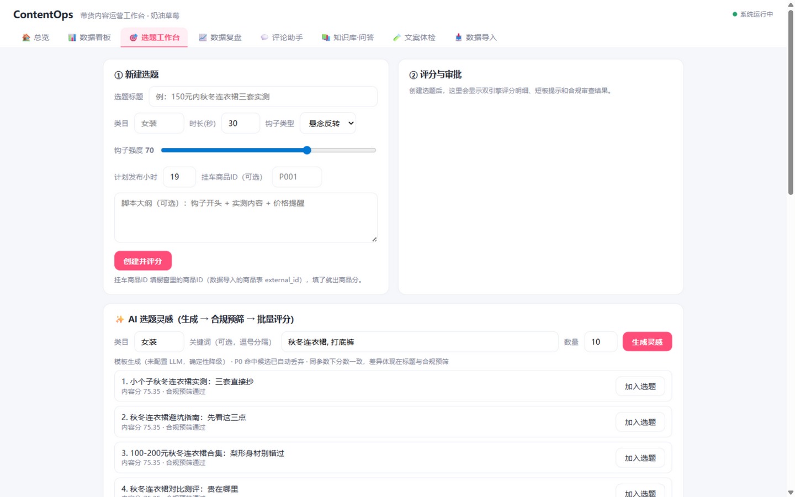
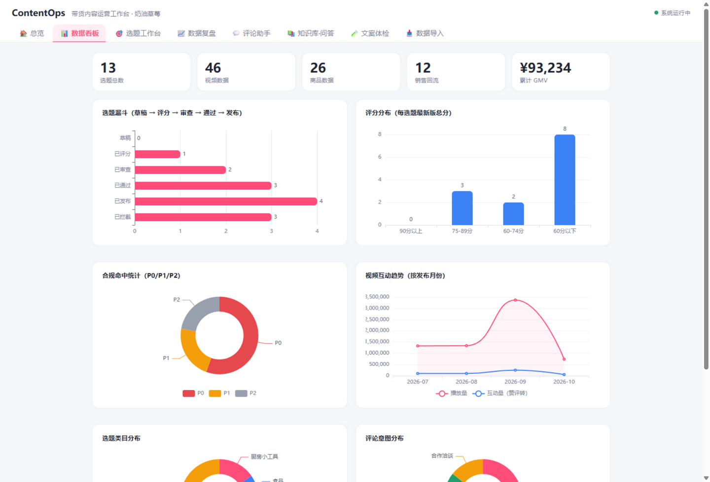
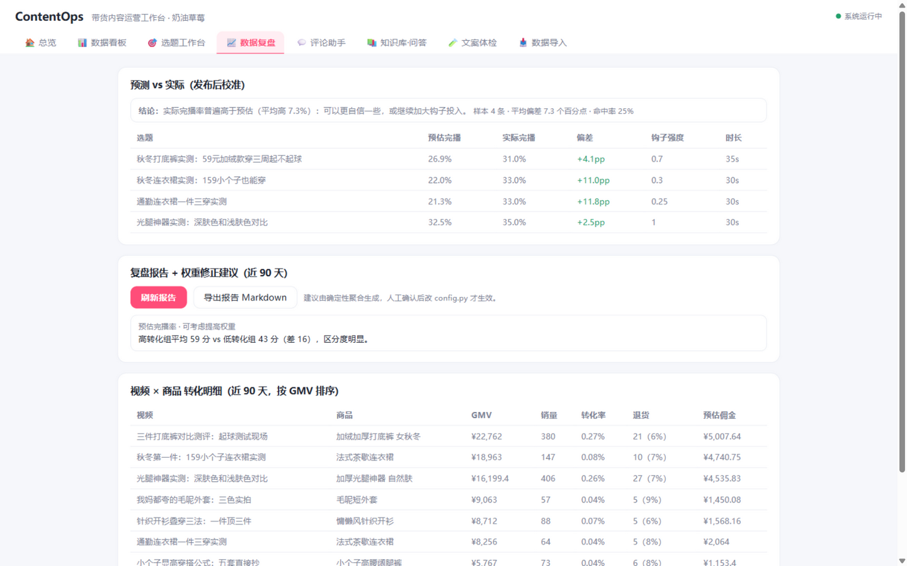
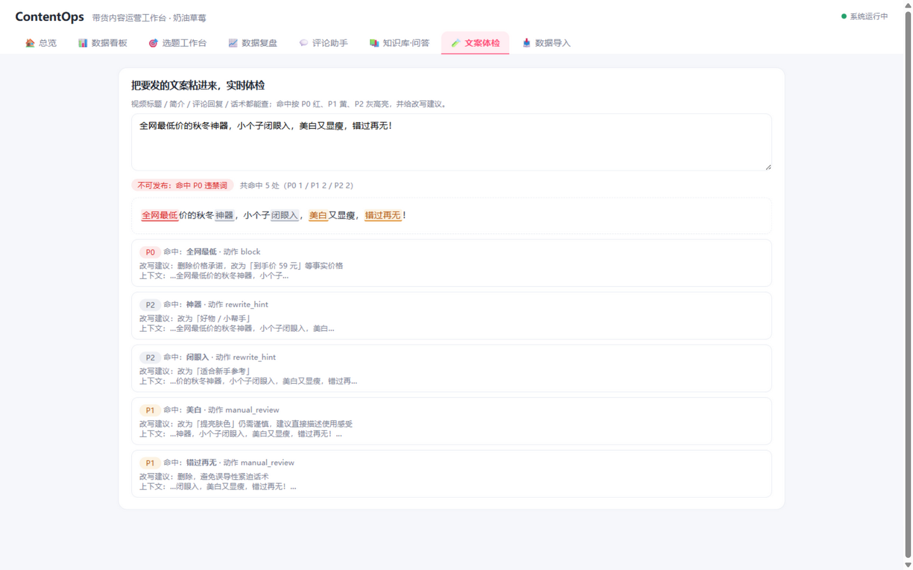

# ContentOps Agent — 带货账号内容运营智能体

> 围绕自有带货类抖音账号的选题 → 评分 → 合规 → 审批 → 复盘全链路工具。
> 数据源是创作者后台导出的真实 CSV，评分全部是确定性可解释计算，不经过大模型编造。

## 界面预览

| 选题工作台（双引擎评分） | 数据看板（ECharts） |
|---|---|
|  |  |

| 数据复盘（预测 vs 实际校准 + 权重建议） | 文案体检（P0/P1/P2 三级高亮） |
|---|---|
|  |  |

## ▶ 在线演示

**https://yanx5433-cmd.github.io/contentops-agent/**

静态交互版，无需安装：评分引擎、合规检查、知识库 BM25 检索、评论意图分类、AI 选题风暴均由后端逻辑移植至浏览器内**真实运行**（数据为演示快照，刷新重置）。完整后端版可用下方一键部署：

[▶ 一键部署到 Render（免费档）](https://render.com/deploy?repo=https://github.com/yanx5433-cmd/contentops-agent)

## 核心设计原则

1. **事实与决策分离**：播放/转化/退货数据只存导入快照（`video_fact`/`product_fact` 只增不改），评分每次现算落版本化快照——避免旧数据冒充事实。
2. **确定性优先**：评分引擎、合规过滤全是规则计算，可复算、可审计、可离线测试（72 项 pytest 全离线通过）。
3. **最小权限**：写操作类工具默认关闭（自动发布、权重自动回写默认 `0`），用环境变量逐个开启。
4. **P0/P1/P2 三级合规**：P0 确定性拦截不进审批，P1 强制人工终审，P2 仅改写提示。商品侧叠加资质检查（缺证直接拦截）。

## 快速开始

```bash
cd contentops-agent
python -m venv .venv
.venv/Scripts/python -m pip install -r requirements.txt

# 建表（生产路径）
.venv/Scripts/python -m alembic upgrade head

# 启动
.venv/Scripts/python -m uvicorn app.main:app --port 8100
# 文档: http://localhost:8100/docs

# 测试（全部离线，不需要任何 API Key）
.venv/Scripts/python -m pytest
```

## 使用流程

```
1. POST /api/import/videos    导入创作者后台视频数据 CSV（列见下）
2. POST /api/import/products  导入橱窗/挂车商品 CSV
3. POST /api/topics           建选题（可挂 product_external_id 进带货位）
4. POST /api/topics/{id}/score?publish_hour=19   双引擎评分，输出版本化明细
5. POST /api/topics/{id}/review                  合规审查（P0 直接 rejected）
6. POST /api/topics/{id}/approve                 人工审批 approved/rejected
7. GET  /api/audit             全链路审计日志

内容知识库（RAG）：
- POST /api/kb/query          爆款结构/选题模式/合规要点检索（带来源引用）
- POST /api/kb/reload         知识库文件更新后重载索引

评论运营助手：
- POST /api/comments/draft            评论 → 意图分类 + 回复草稿（不发送）
- GET  /api/comments/drafts?status=   草稿列表
- POST /api/comments/drafts/{id}/finalize  人工定稿（edited/sent/discarded）

看板 / 复盘 / 校准 / 质检 / 风暴 / AI 配置（第 3 周）：
- POST /api/compliance/check-text     文案体检：任意文案实时查违禁词 + 改写建议
- POST /api/brainstorm                AI 选题风暴：生成 → 合规预筛 → 批量评分（不入库，确认后手动加入）
- GET  /api/dashboard                 运营看板聚合（漏斗/评分分布/合规/趋势/类目/评论意图）
- POST /api/import/sales              销售回流导入（复盘与校准的数据源）
- GET  /api/review/conversion         视频×商品转化明细（GMV / 转化率 / 退货 / 预估佣金）
- GET  /api/review/report             复盘报告 + 权重修正建议（Markdown 可导出，人工确认后生效）
- GET  /api/review/calibration        预测 vs 实际：评分预估完播率 vs 真实完播率校准
- POST /api/topics/{id}/publish       发布挂接（关联真实视频，供校准使用）
- GET/PUT /api/settings/llm           LLM 接入配置（界面配置、Key 打码、每日调用限额）
```

### LLM 接入（可选）

系统默认无 Key 完全可用（RAG 返回原文片段、评论分类走关键词规则）。配置后增强：

```bash
export LLM_API_KEY=sk-xxx        # 任意 OpenAI 兼容服务（DeepSeek/通义/Kimi）
export LLM_BASE_URL=https://api.deepseek.com/v1
export LLM_MODEL=deepseek-chat
```

### CSV 格式

**videos**（必需列：`external_id,title,views,finish_rate`；可选：`published_at,duration_sec,likes,comments,shares,new_followers`）

**products**（必需列：`external_id,title,category,price,commission_rate`；可选：`sales_count,return_rate,required_licenses`，多资质用 `|` 分隔）

样例见 `data/raw/`。UTF-8（含 BOM），≤5MB，先全量校验、有错整批拒绝。

## 选题双引擎

**内容分**（权重 0.6）：预估完播率 0.30 / 垂类热度 0.20 / 竞争饱和度 0.15 / 粉丝画像匹配 0.20 / 发布时段 0.15

**商品分**（权重 0.4，无挂车选题该引擎不启用）：佣金比例 0.30 / 同类目转化历史 0.25 / 价格带匹配 0.25 / 退货风险 0.20

每个维度输出 0-100 分 + 依据说明；低于 60 分的维度进 `weaknesses` 短板提示。权重集中在 `app/config.py`，复盘模块产出的权重修正建议**不直接生效**，须人工确认后修改配置。

## 技术栈

FastAPI + SQLAlchemy 2.0 + SQLite + Alembic + Pydantic v2 + pytest + ECharts（本地化静态引入）

## 目录结构

```
app/
  config.py          # 权重、合规分级、工具权限开关、LLM 接入
  database.py        # 会话
  main.py            # 入口
  models/            # 9 张表：画像/事实/选题/评分/合规/审批/评论草稿/审计
  schemas/           # Pydantic 模型
  services/
    scoring.py       # 双引擎评分（确定性）
    compliance.py    # 违禁词三级 + 资质检查 + 文案体检高亮/改写建议
    importer.py      # CSV 校验导入（视频/商品/销售回流，整批拒绝、快照只增）
    rag.py           # 知识库 BM25 检索（纯标准库，带来源引用）
    comment_assistant.py  # 评论意图分类 + 话术库草稿
    llm.py           # LLM 可选接入层（OpenAI 兼容，无 Key 降级，每日限额）
    analytics.py     # 看板聚合 / 复盘报告与权重建议 / 预测校准
    brainstorm.py    # AI 选题风暴（LLM/模板双路 + 合规预筛 + 批量评分）
  routers/api.py     # 全部 REST 路由
alembic/             # 迁移
data/knowledge/      # 知识库（女装爆款结构/选题模式库/带货合规要点，Markdown 人工维护）
data/raw/            # 样例数据（30 条视频 + 16 个商品）
scripts/fill_profile.py  # 账号画像填数（含后台数据来源注释）
tests/               # 72 项离线测试
```

## 路线图（详见 docs/ROADMAP.md）

- [x] 第 1 周最小闭环：导入 + 双引擎评分 + 合规 + 审批 + 审计 ✅ 已完成
- [x] 第 2 周：爆款拆解 RAG（BM25 + 来源引用）、评论意图分类助手（草稿 + 人工定稿）、LLM 可选接入层（无 Key 模板降级）✅ 已完成
- [x] 第 3 周：复盘闭环（销售回流 → 转化明细 → 权重修正建议）、ECharts 运营看板、文案体检、AI 选题风暴、预测 vs 实际校准、LLM 界面配置（每日限额）✅ 已完成

## 说明

- 违禁词库与类目资质表是种子版本，发布前以平台官方规则为准，不构成法律意见。
- 本项目不做自动发布（`ENABLE_AUTO_PUBLISH` 默认 0）：内容发布由人执行，系统止步于审批。
